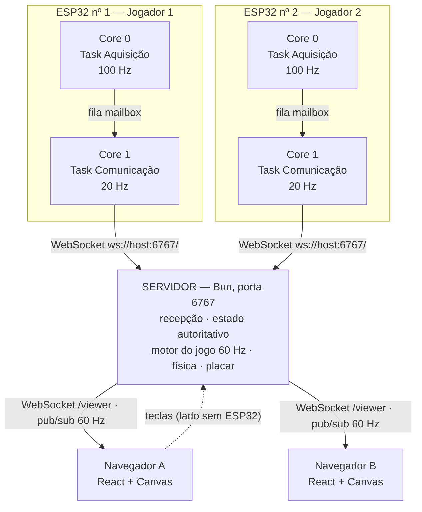

# Relatório Técnico — Pong Distribuído com ESP32 e Processamento Paralelo

**Disciplina:** Programação Concorrente e Paralela
**Integrantes:** _(preencher)_
**Repositório:** <https://github.com/DaniloRC92/Pong-Distribuido>

---

## Sumário

1. [Introdução](#1-introdução)
2. [Arquitetura da solução](#2-arquitetura-da-solução)
3. [Sistema embarcado](#3-sistema-embarcado)
4. [Aquisição do acelerômetro](#4-aquisição-do-acelerômetro)
5. [Paralelismo e concorrência](#5-paralelismo-e-concorrência)
6. [Comunicação entre tarefas](#6-comunicação-entre-tarefas)
7. [Comunicação em rede](#7-comunicação-em-rede)
8. [Servidor](#8-servidor)
9. [Motor e estado do jogo](#9-motor-e-estado-do-jogo)
10. [Interface Web](#10-interface-web)
11. [Estratégias de sincronização](#11-estratégias-de-sincronização)
12. [Experimentos](#12-experimentos)
13. [Resultados](#13-resultados)
14. [Limitações](#14-limitações)
15. [Conclusão](#15-conclusão)
- [Anexo A — Questões do enunciado](#anexo-a--questões-do-enunciado)

---

## 1. Introdução

Este relatório descreve a concepção, a implementação e a avaliação de um sistema interativo
paralelo e distribuído em que dois dispositivos ESP32, cada um equipado com um acelerômetro
MMA8452, funcionam como controles físicos de um jogo inspirado no clássico Pong.

O jogo não é o objetivo do trabalho. Ele é o instrumento que torna **visível** o comportamento
de um sistema distribuído: qualquer atraso de rede, qualquer perda de sincronização e qualquer
erro de concorrência aparecem imediatamente como um movimento travado, uma raquete que não
responde ou duas telas mostrando partidas diferentes. O Pong funciona, portanto, como um
osciloscópio do sistema.

Três problemas computacionais distintos são exercitados, e a distinção entre eles é central
para o trabalho:

| Problema | Onde ocorre | Natureza |
|----------|-------------|----------|
| **Paralelismo** | Dentro de cada ESP32 | Duas tarefas em núcleos físicos distintos executando *ao mesmo tempo* |
| **Concorrência** | No servidor | Eventos de origens independentes disputando o mesmo estado, intercalados no tempo |
| **Distribuição** | No sistema como um todo | Processos em máquinas fisicamente separadas cooperando pela rede |

O sistema foi construído sobre três decisões arquiteturais que atravessam todo o relatório:

1. **A aquisição do sensor nunca depende da rede.** Produtor e consumidor vivem em núcleos
   diferentes e se comunicam por uma fila que o produtor jamais bloqueia.
2. **O servidor é a única autoridade sobre a partida.** Nenhum navegador simula física,
   contabiliza pontos ou decide colisões.
3. **Dados de controle envelhecem.** Quando a amostra mais nova chega antes que a anterior
   tenha sido consumida, a antiga é descartada — nunca enfileirada.

As seções seguintes detalham cada camada, os mecanismos de sincronização escolhidos, os cinco
experimentos exigidos no enunciado e os resultados obtidos. O [Anexo A](#anexo-a--questões-do-enunciado)
responde explicitamente às vinte questões propostas.

---

## 2. Arquitetura da solução

O sistema é composto por quatro elementos independentes, distribuídos em pelo menos três
máquinas distintas.



### 2.1. Camadas e responsabilidades

| Camada | Tecnologia | Responsabilidade | O que **não** faz |
|--------|------------|------------------|-------------------|
| Embarcada | ESP32 + MMA8452, C++ / FreeRTOS | Ler a aceleração e transmiti-la | Não interpreta o movimento nem conhece as regras do jogo |
| Servidor | Bun + TypeScript | Manter o estado da partida e executar a lógica | Não desenha |
| Interface | React + Canvas | Desenhar o estado recebido | Não simula física, não conta pontos |
| Rede | WebSocket sobre TCP/IP | Transportar amostras e estado | — |

### 2.2. Fluxo completo de um movimento

```
movimento físico da protoboard
   └─> MMA8452 converte em aceleração (100 Hz, ±2 g, 12 bits)
        └─> Task Aquisição (Core 0) lê por I²C e grava na fila
             └─> Task Comunicação (Core 1) lê a fila e envia por WebSocket (20 Hz)
                  └─> Servidor recebe, valida e guarda a última amostra do dispositivo
                       └─> step() a 60 Hz converte inclinação em posição de raquete
                            └─> física: bola, colisões, pontuação
                                 └─> publish do estado no tópico "viewers"
                                      └─> navegador guarda o estado num ref
                                           └─> requestAnimationFrame desenha o canvas
                                                └─> movimento percebido na tela
```

### 2.3. Decisão: onde interpretar o movimento

O enunciado permite que o ESP32 transmita valores brutos ou já interpretados (`UP`, `DOWN`,
`POSITION=-0.73`). Optou-se por transmitir **os três eixos em bruto, em g**, e concentrar toda
a interpretação no servidor.

**Justificativa.** Calibração, sensibilidade, limiar e suavização são parâmetros que precisam
ser ajustados muitas vezes durante os testes. Mantidos no servidor, cada ajuste custa editar
uma constante em `main.ts` e salvar o arquivo — o `bun --hot` recarrega sozinho. Mantidos no
firmware, cada ajuste custaria recompilar e regravar **duas** placas. O custo é desprezível: a
mensagem cresce em cerca de 30 bytes e, a 20 Hz, isso representa 600 B/s por dispositivo.

Um efeito colateral desejável é que o firmware fica genérico. Ele não sabe que existe um jogo
de Pong: apenas publica aceleração. Trocar o jogo não exige tocar no código embarcado.

---

## 3. Sistema embarcado

### 3.1. Hardware

Cada jogador dispõe de um conjunto montado numa protoboard, que é manipulada fisicamente
durante a partida.

| Componente | Especificação relevante |
|------------|-------------------------|
| ESP32-WROOM-32 | Dois núcleos Xtensa LX6 a 240 MHz, Wi-Fi 2,4 GHz, FreeRTOS no SDK |
| MMA8452Q | Acelerômetro triaxial, saída de 12 bits, interface I²C, escalas ±2/±4/±8 g |

Ligação I²C:

| MMA8452 | ESP32 |
|---------|-------|
| VCC | 3V3 |
| GND | GND |
| SDA | GPIO21 |
| SCL | GPIO22 |

O endereço do sensor é `0x1D` (pino `SA0` alto) ou `0x1C` (`SA0` em GND).

### 3.2. Firmware parametrizado

Os dois dispositivos executam **o mesmo binário**, diferenciados apenas pela constante
`DEVICE_ID` (`"esp32-01"` e `"esp32-02"`). Essa escolha atende à recomendação do enunciado e
tem uma consequência prática relevante: qualquer correção de firmware é validada uma vez e
gravada identicamente nas duas placas, eliminando a classe de defeitos em que os dois
dispositivos divergem de comportamento.

O identificador viaja em **todas** as mensagens, e não apenas no `hello`. O servidor, portanto,
nunca depende de memorizar qual conexão pertence a qual jogador: cada mensagem se identifica
sozinha. Isso torna a reconexão trivial — uma placa que cai e volta é reconhecida pelo conteúdo
da primeira mensagem, sem qualquer protocolo de restabelecimento de sessão.

### 3.3. Estrutura do software embarcado

O firmware é organizado em duas tarefas FreeRTOS fixadas em núcleos distintos, mais uma fila
que as conecta:

| Tarefa | Núcleo | Período | Responsabilidade |
|--------|--------|---------|------------------|
| `TaskAquisicao` | Core 0 | 10 ms (100 Hz) | Inicializar e ler o MMA8452, filtrar e produzir amostras |
| `TaskComunicacao` | Core 1 | 50 ms (20 Hz) | Wi-Fi, WebSocket, consumo da fila, envio, reconexão |

A escolha dos núcleos não é arbitrária. No ESP32 com Arduino, a pilha Wi-Fi e o `loopTask`
executam por padrão no **Core 1**. Manter a comunicação nesse mesmo núcleo preserva a
localidade do trabalho de rede, enquanto o **Core 0** fica disponível para a aquisição, livre
da contenção causada pelas interrupções e pelos bloqueios da pilha Wi-Fi. É essa separação
física que sustenta o requisito central do trabalho: **problemas de rede não bloqueiam a
aquisição do sensor**.

---

## 4. Aquisição do acelerômetro

### 4.1. Configuração do sensor

O MMA8452 é configurado por escrita direta em registradores, sem biblioteca de terceiros:

| Registrador | Valor | Significado |
|-------------|-------|-------------|
| `0x0D` (`WHO_AM_I`) | leitura, espera `0x2A` | Verificação de presença do sensor |
| `0x2A` (`CTRL_REG1`) | `0x00` | Modo *standby* — obrigatório antes de reconfigurar |
| `0x0E` (`XYZ_DATA_CFG`) | `0x00` | Fundo de escala **±2 g** |
| `0x2A` (`CTRL_REG1`) | `0x19` | ODR **100 Hz** + modo ativo |

A leitura é feita em burst a partir de `0x01` (`OUT_X_MSB`), capturando seis bytes — MSB e LSB
dos três eixos — numa única transação I²C. Cada par de bytes forma um inteiro de 12 bits
alinhado à esquerda, convertido para g por:

```cpp
g[i] = ((int16_t)((msb << 8) | lsb) >> 4) / 1024.0f;   // 1024 contagens por g em ±2 g
```

O burst de seis bytes é deliberado: ler os eixos em três transações separadas abriria uma
janela entre elas em que o sensor pode atualizar seus registradores, produzindo uma amostra
composta por eixos de instantes diferentes. Com a leitura única, os três eixos pertencem
sempre ao mesmo instante de amostragem.

### 4.2. Justificativa da escala e da resolução

A escala **±2 g** é a mais estreita que o sensor oferece e, por isso, a de maior resolução:
1024 contagens por g, ou aproximadamente 0,98 mg por bit. A aplicação mede **inclinação
estática**, não impacto: com a protoboard parada, o vetor medido é a gravidade, de módulo 1 g,
e a componente no eixo de interesse varia entre −1 g e +1 g. Escalas mais largas (±4 g, ±8 g)
só seriam necessárias para detectar choques e custariam metade ou um quarto da resolução
angular, sem benefício algum para o controle da raquete.

### 4.3. Justificativa da frequência de aquisição (100 Hz)

A frequência de 100 Hz resulta de três limites simultâneos:

**Limite inferior — resposta percebida.** O movimento humano de inclinar uma protoboard tem
conteúdo espectral útil até cerca de 10 Hz. Pelo critério de Nyquist, 20 Hz seriam o mínimo
teórico; na prática, amostrar com folga permite filtrar ruído sem destruir o sinal. Além disso,
quem joga percebe atraso acima de aproximadamente 100 ms, e a aquisição é apenas uma das oito
etapas do caminho — ela precisa custar bem menos do que esse orçamento.

**Limite inferior — qualidade da filtragem.** A média móvel descrita em 4.4 só tem efeito se
houver amostras em quantidade suficiente dentro do intervalo de transmissão. A 100 Hz, cada
envio a 20 Hz resume cinco leituras; a 20 Hz, cada envio seria uma leitura isolada e o ruído
chegaria inteiro ao servidor.

**Limite superior — custo e utilidade.** O ODR seguinte do sensor é 200 Hz, o que dobraria o
tráfego I²C sem acrescentar informação: nenhum movimento de mão produz conteúdo a 100 Hz. O
ganho seria nulo e o consumo, maior.

**A 100 Hz há ainda uma margem de projeto confortável.** O período de 10 ms é mais de uma ordem
de grandeza maior que o tempo da transação I²C (seção 13), de modo que a tarefa de aquisição
permanece ociosa durante a maior parte de cada ciclo.

### 4.4. Tratamento do sinal real

O sinal bruto de um acelerômetro apresenta três problemas práticos, tratados assim:

| Problema | Tratamento | Onde |
|----------|------------|------|
| **Ruído de alta frequência** | Média móvel das últimas 5 leituras | Task Aquisição (ESP32) |
| **Offset de repouso** | Captura da média dos primeiros 100 ms como referência zero | Task Aquisição (ESP32) |
| **Oscilação da mão parada** | Filtro exponencial de primeira ordem sobre a posição da raquete | Servidor (`TILT_SMOOTHING`) |
| **Sensibilidade e limiar** | Normalização por `FULL_TILT` com saturação em ±1 | Servidor (`tiltOf()`) |

A divisão é intencional. O que depende apenas do **sensor** — ruído de quantização e offset de
montagem — é tratado no dispositivo, onde há acesso a todas as amostras. O que depende do
**jogo** — sensibilidade, limiar, suavização — é tratado no servidor, onde pode ser ajustado
sem regravar firmware.

No servidor, a conversão de inclinação em posição é:

```ts
tilt   = clamp(amostra[AXIS] / FULL_TILT, -1, 1)      // FULL_TILT = 0.6 g
target = PADDLE_CENTER - tilt * PADDLE_CENTER          // PADDLE_CENTER = 210 px
y     += (target - y) * TILT_SMOOTHING                 // TILT_SMOOTHING = 0.3
```

Com `FULL_TILT = 0.6 g`, a raquete percorre a arena inteira com cerca de **37° de inclinação**
(arcsen 0,6) — amplitude confortável para o pulso, sem exigir virar a protoboard de cabeça para
baixo. A saturação em ±1 garante que inclinações maiores simplesmente mantenham a raquete no
extremo, em vez de produzir posições fora da arena.

O filtro exponencial com fator 0,3, aplicado a 60 Hz, atinge 63 % do alvo em cerca de 47 ms e
95 % em cerca de 140 ms. Esse é o compromisso central do controle: valores maiores tornam a
raquete nervosa e repassam o tremor da mão para a tela; valores menores a deixam suave, porém
lenta demais para interceptar a bola.

---

## 5. Paralelismo e concorrência

Esta seção responde diretamente ao núcleo conceitual do trabalho: distinguir paralelismo de
concorrência e mostrar onde cada um ocorre.

### 5.1. Paralelismo — execução simultânea em hardware distinto

Existe paralelismo **real** em dois lugares:

**Dentro de cada ESP32.** `TaskAquisicao` e `TaskComunicacao` são fixadas em núcleos distintos
(`xTaskCreatePinnedToCore` com `Core 0` e `Core 1`). Elas não se revezam numa CPU: executam
literalmente ao mesmo tempo, em silício diferente. Enquanto o Core 1 aguarda o `ACK` de um
pacote TCP, o Core 0 está lendo o barramento I²C.

**Entre os dispositivos do sistema.** Os dois ESP32, o servidor e os navegadores são máquinas
distintas executando processos simultâneos. Esse é o paralelismo de granularidade grossa,
inerente a qualquer sistema distribuído.

### 5.2. Concorrência — disputa pelo mesmo recurso

Existe concorrência em três pontos, e em nenhum deles ela implica paralelismo:

**Na fila do ESP32.** Produtor e consumidor disputam a mesma estrutura de dados. Como estão em
núcleos diferentes, o acesso pode ser genuinamente simultâneo — e é exatamente por isso que o
mecanismo precisa ser atômico (seção 6).

**No servidor.** As conexões dos dois ESP32, as conexões dos navegadores e o laço do motor do
jogo são atividades logicamente concorrentes: cada uma pode precisar tocar o mesmo estado da
partida, em ordem imprevisível. O JavaScript, porém, as executa num **único event loop** — elas
se intercalam, mas nunca se sobrepõem.

**No navegador.** O `onmessage` do WebSocket e o laço de desenho do `requestAnimationFrame`
acessam o mesmo objeto de estado, também de forma intercalada no event loop do navegador.

### 5.3. O quadro completo

| Local | Atividades | Paralelo? | Concorrente? | Tratamento |
|-------|-----------|-----------|--------------|------------|
| ESP32 | Aquisição × Comunicação | **Sim** (Core 0 × Core 1) | Sim | Fila FreeRTOS atômica |
| Servidor | Handlers × motor do jogo | Não (event loop único) | Sim | Serialização por construção |
| Navegador | `onmessage` × `rAF` | Não | Sim | Serialização por construção |
| Sistema | ESP32 #1 × ESP32 #2 × servidor × navegadores | **Sim** | Sim | Estado autoritativo único |

A lição prática que o projeto evidencia é que **concorrência é o problema; paralelismo é apenas
uma das formas de realizá-la**. No ESP32, onde há paralelismo verdadeiro, foi preciso um
mecanismo explícito de sincronização. No servidor, onde há concorrência sem paralelismo, o
modelo de execução já garante a exclusão mútua — e reconhecer isso evitou introduzir locks
desnecessários, que só acrescentariam custo e risco de erro.

---

## 6. Comunicação entre tarefas

### 6.1. O recurso compartilhado

O único dado compartilhado entre as duas tarefas do ESP32 é **a amostra mais recente do
acelerômetro**: a estrutura com os três eixos em g e a marca temporal da leitura.

```c
typedef struct {
  uint32_t t;        // millis() no instante da leitura
  float    x, y, z;  // aceleração em g
} Amostra;
```

### 6.2. A condição de corrida que existiria sem sincronização

A estrutura tem 16 bytes. Nenhuma arquitetura de 32 bits a escreve atomicamente: são quatro
escritas de 32 bits. Se as tarefas compartilhassem simplesmente uma variável global, a
sequência abaixo seria possível — e, com as tarefas em núcleos distintos, **provável**:

```
Core 0 (Aquisição)                  Core 1 (Comunicação)
-------------------                 ---------------------
escreve t  = 1000
escreve x  = 0.10
                                    lê t = 1000
                                    lê x = 0.10
                                    lê y = 0.90   <- valor da amostra ANTERIOR
escreve y  = 0.45
escreve z  = 0.89
                                    lê z = 0.89
```

A mensagem transmitida conteria `x` e `z` da amostra nova, `y` da amostra antiga e um `t` que
não corresponde a nenhuma das duas. Esse é o **tearing** (leitura rasgada) clássico. Como
`AXIS = "y"`, o campo corrompido seria justamente o que controla a raquete, e o efeito visível
seria um salto esporádico e irreprodutível da raquete na tela — o tipo de defeito que não
aparece em teste curto e se manifesta na demonstração.

Há ainda uma segunda corrida, mais sutil: a leitura poderia ocorrer **antes da primeira
escrita completa**, no arranque, transmitindo lixo da memória não inicializada.

### 6.3. Mecanismo escolhido: fila FreeRTOS de um elemento (*mailbox*)

Foi adotada uma **fila FreeRTOS de capacidade 1**, operada no padrão *mailbox*:

```c
QueueHandle_t filaAmostra;                       // xQueueCreate(1, sizeof(Amostra))

// Produtor — Task Aquisição (Core 0): nunca bloqueia, sempre sobrescreve
xQueueOverwrite(filaAmostra, &amostra);

// Consumidor — Task Comunicação (Core 1): espera no máximo o período de envio
if (xQueueReceive(filaAmostra, &amostra, pdMS_TO_TICKS(SEND_INTERVAL_MS)) == pdTRUE) {
    enviaAmostra(&amostra);
}
```

### 6.4. Por que esse mecanismo

A escolha foi comparada com as alternativas previstas no enunciado:

| Mecanismo | Avaliação |
|-----------|-----------|
| **Variável global simples** | Descartado: sofre exatamente o *tearing* da seção 6.2 |
| **Mutex sobre variável compartilhada** | Correto, porém o produtor pode ficar bloqueado esperando o consumidor liberar o lock — justamente o que não se pode permitir na aquisição. Exige ainda disciplina manual de `lock`/`unlock` em todos os caminhos de saída |
| **Semáforo contador** | Resolve a sinalização, mas não transfere o dado: ainda seria preciso um buffer protegido à parte |
| **Fila longa (N elementos)** | Descartado pelo argumento de 6.5: acumula amostras velhas e converte atraso em fila crescente |
| **Buffer circular artesanal** | Equivalente em desempenho, porém exigiria implementar a atomicidade manualmente, com barreiras de memória — risco desnecessário quando o SDK já oferece a primitiva pronta e testada |
| **Fila de 1 com sobrescrita** | **Adotado** |

Os quatro argumentos decisivos:

1. **O produtor nunca bloqueia.** `xQueueOverwrite` retorna imediatamente, com ou sem
   consumidor disponível. A tarefa de aquisição mantém seu período de 10 ms sob qualquer
   condição de rede — o requisito explícito do enunciado.
2. **A atomicidade é garantida pelo SDK.** O FreeRTOS protege a fila com seção crítica, válida
   entre núcleos. A amostra entregue é sempre coerente: nenhum *tearing* é possível.
3. **O consumidor recebe sempre a amostra mais fresca.** Como a capacidade é 1, não há fila de
   dados velhos: o que o consumidor lê é o estado mais recente do mundo físico.
4. **O consumidor dorme enquanto espera.** `xQueueReceive` com *timeout* devolve o núcleo ao
   escalonador em vez de consumir CPU em *polling*.

### 6.5. A semântica fundamental: dados de controle envelhecem

A decisão de descartar amostras não é uma concessão de desempenho — é a modelagem correta do
problema. Uma amostra de acelerômetro é uma **medida de um instante**, não um evento a ser
processado. Se a amostra do instante *t* não foi transmitida até o instante *t*+50 ms, ela não
descreve mais a posição da protoboard: entregá-la atrasada faria a raquete ir para onde a mão
**estava**, e não para onde está.

O contraste com uma fila longa é direto. Com capacidade N, o atraso cresceria sem limite
durante uma lentidão de rede, e ao restabelecer a conexão o servidor receberia uma rajada de
amostras obsoletas — a raquete "correria atrás do prejuízo", reproduzindo em segundos um
movimento feito há muito tempo. Com a fila de 1, o pior caso de atraso é fixo em um período de
transmissão e a raquete sempre reflete o presente.

É a mesma razão pela qual o servidor guarda apenas `samples.set(device, msg)` — a **última**
amostra de cada dispositivo, e não um histórico. A política de descarte é coerente em todo o
caminho de dados.

---

## 7. Comunicação em rede

### 7.1. Escolha do transporte

A comunicação usa **WebSocket sobre TCP/IP**, conforme exigido no enunciado. Em todos os três
enlaces do sistema:

| Enlace | Endpoint | Direção | Taxa |
|--------|----------|---------|------|
| ESP32 → servidor | `ws://host:6767/` | Unidirecional na prática | 20 msg/s por dispositivo |
| Servidor → navegador | `ws://host:6767/viewer` | Difusão por tópico | 60 msg/s por navegador |
| Navegador → servidor | mesmo canal `/viewer` | Eventual | Apenas em transição de tecla |

O WebSocket oferece o que a aplicação precisa e um polling HTTP não ofereceria: canal
persistente, sem o custo de um handshake por mensagem, **bidirecional** e com *push* do
servidor para o cliente. É esse último ponto que viabiliza o modelo: é o servidor quem decide
quando o estado mudou, e não o navegador quem precisa perguntar.

### 7.2. Identificação inequívoca dos jogadores

O enunciado sugere endpoints distintos (`/ws/player1`, `/ws/player2`), mas admite estratégia
equivalente. Adotou-se **um único endpoint com identificação no conteúdo da mensagem**:

```ts
const slots: Record<Side, string | null> = { left: null, right: null };

function assign(id: string) {
  if (slots.left === id || slots.right === id) return;  // idempotente
  if (!slots.left) slots.left = id;                     // 1º dispositivo = Jogador 1
  else if (!slots.right) slots.right = id;              // 2º dispositivo = Jogador 2
}
```

A atribuição ocorre na primeira mensagem `accel` de um `DEVICE_ID` ainda não registrado. O
requisito do enunciado — **duas conexões independentes e simultâneas, correspondentes aos dois
dispositivos físicos** — é plenamente atendido: cada ESP32 mantém seu próprio socket TCP, com
seu próprio estado de conexão.

**Por que a identificação está na mensagem e não na URL.** A alternativa com dois endpoints
amarra a identidade ao *canal*. Se a placa 2 reiniciar e reconectar, o servidor precisaria
descobrir que aquele novo socket em `/ws/player2` substitui o anterior e descartar o estado do
socket morto — um protocolo de sessão explícito. Com a identidade **na mensagem**, nada disso é
necessário: cada mensagem se identifica sozinha, `assign()` é idempotente e a reconexão se
resolve naturalmente, porque o primeiro `accel` da placa que voltou já carrega seu
`DEVICE_ID`. Em troca, perde-se a capacidade de fixar qual lado cada placa ocupa — o que, nesta
aplicação, é resolvido pela ordem de ligação.

### 7.3. Validação de entrada

Mensagens que chegam da rede nunca são tratadas como confiáveis. Toda mensagem passa por um
validador antes que qualquer campo seja usado:

```ts
function parse(raw: string | Buffer): DeviceMsg | null {
  const m = decode(raw);                                       // JSON.parse protegido por try/catch
  if (typeof m?.device !== "string" || m.device === "") return null;
  if (m.type === "hello" && typeof m.scale === "number") return m;
  if (m.type === "accel" && [m.t, m.x, m.y, m.z].every(Number.isFinite)) return m;
  return null;
}
```

O uso de `Number.isFinite` é deliberado: ele rejeita `NaN` e `Infinity`, que `typeof === "number"`
aceitaria. Um `NaN` vindo de uma leitura defeituosa do sensor se propagaria silenciosamente pela
física — `clamp(NaN, 0, 420)` devolve `NaN`, a posição da raquete deixaria de ser um número e a
partida inteira travaria sem erro aparente. A validação na fronteira impede que um único bit
ruim contamine o estado global.

Mensagem inválida é descartada com aviso no log, **sem derrubar a conexão**: um pacote
corrompido não deve custar ao jogador o restabelecimento do canal.

### 7.4. Tratamento de desconexão e reconexão

Os três enlaces recuperam-se automaticamente, cada um com uma estratégia adequada ao seu lado:

| Enlace | Detecção | Recuperação |
|--------|----------|-------------|
| ESP32 → servidor | Evento `WStype_DISCONNECTED` da biblioteca | `ws.setReconnectInterval(3000)` — nova tentativa a cada 3 s |
| ESP32 → Wi-Fi | Perda de associação | `WiFi.setAutoReconnect(true)` — reassociação automática |
| Navegador → servidor | `ws.onclose` | `setTimeout(connect, 2000)` — nova tentativa a cada 2 s |

Do lado do servidor, o `close` de um dispositivo executa a limpeza correspondente:

```ts
samples.delete(id);   // a última amostra deixa de existir
release(id);          // o slot volta a ficar livre
```

Com a amostra removida, `tiltOf(side)` passa a devolver `null` e a raquete daquele lado deixa
de seguir a inclinação. Com o slot liberado, o lado volta a aceitar comandos de teclado — a
partida continua jogável, ainda que com um jogador a menos. A alternativa, manter a última
amostra, deixaria uma raquete fantasma congelada numa posição arbitrária, o que seria pior do
que devolvê-la ao controle manual.

O `close` de um navegador trata um caso específico: se a aba foi fechada com uma tecla
pressionada, o servidor jamais receberia o `dir: 0` correspondente e a raquete ficaria subindo
indefinidamente. Por isso o servidor registra, em `keyOwner`, qual conexão deu a última ordem
de movimento de cada lado, e zera o comando quando essa conexão específica cai.

---

## 8. Servidor

### 8.1. Plataforma

O servidor é implementado em **TypeScript estrito sobre o runtime Bun**, que fornece servidor
HTTP, servidor WebSocket com *pub/sub* nativo e empacotamento do frontend num único processo,
sem dependências externas além do React.

O *pub/sub* nativo merece destaque. Em vez de iterar sobre uma lista de conexões e chamar
`send` em cada uma, o servidor publica uma vez num tópico:

```ts
server.publish(VIEWERS, stateMsg());
```

O frame WebSocket é serializado **uma única vez** e escrito em todos os sockets inscritos. A
60 Hz, com várias abas abertas, isso elimina o custo repetido de serialização que domina um
laço de difusão ingênuo.

### 8.2. Roteamento e papéis

O `fetch` separa os três tipos de acesso e registra o papel na conexão no momento do upgrade:

```ts
if (pathname === "/") {
  if (server.upgrade(req, { data: { role: "device" } })) return;
  return new Response(null, { status: 302, headers: { Location: "/game" } });
}
if (pathname === "/viewer") {
  if (server.upgrade(req, { data: { role: "viewer" } })) return;
  return new Response("Esperado WebSocket", { status: 426 });
}
```

O papel é fixado no `upgrade` e nunca muda durante a vida da conexão. O handler `message`
consulta `ws.data.role` antes de qualquer outra coisa e aplica o validador correspondente — um
navegador não consegue enviar mensagens de dispositivo nem o contrário, por construção.

O redirecionamento de `/` para `/game` é uma conveniência de demonstração: quem digita apenas o
IP e a porta no navegador, sem o caminho, chega à interface em vez de receber um erro de
protocolo.

### 8.3. Processamento concorrente de eventos

O servidor recebe, de forma independente e assíncrona:

- mensagens `accel` do ESP32 #1 (20/s);
- mensagens `accel` do ESP32 #2 (20/s);
- mensagens `key` de qualquer navegador (eventuais);
- aberturas e fechamentos de conexão, a qualquer momento;
- o disparo periódico do motor do jogo (60/s).

Essas atividades são **logicamente concorrentes** — chegam de origens independentes, em ordem
imprevisível. O tratamento, descrito em detalhe na seção 11, apoia-se no modelo de execução do
event loop: elas se intercalam, mas nunca se sobrepõem.

### 8.4. Recepção de amostras

```ts
samples.set(msg.device, msg);   // sobrescreve a amostra anterior do dispositivo
assign(msg.device);             // idempotente a partir da segunda chamada
```

O handler é deliberadamente trivial. Ele **não** executa física, não calcula posições e não
difunde nada — apenas registra o fato observado e retorna. Toda a lógica acontece no tick do
motor do jogo.

Essa separação tem uma consequência importante: o custo de processar uma mensagem recebida é
constante e mínimo, independentemente do número de dispositivos ou da taxa de chegada. Um ESP32
que, por defeito, passasse a enviar a 1 kHz aumentaria o uso de CPU na recepção, mas **não
afetaria a taxa de simulação nem a de difusão** — o motor continuaria a 60 Hz e os navegadores
continuariam recebendo 60 mensagens por segundo. A frequência de entrada está desacoplada da
frequência de processamento.

---

## 9. Motor e estado do jogo

### 9.1. O estado global da partida

O estado autoritativo vive inteiramente no servidor e é composto por:

| Dado | Estrutura | Difundido? |
|------|-----------|------------|
| Posição da raquete esquerda | `game.leftY` | Sim |
| Posição da raquete direita | `game.rightY` | Sim |
| Posição da bola | `game.ball.x`, `game.ball.y` | Sim |
| **Velocidade da bola** | `game.ball.vx`, `game.ball.vy` | **Não** |
| Pontuação | `game.score` | Sim |
| Vencedor e contagem da pausa | `game.winner`, `game.winTicks` | Parcialmente (`winner`) |
| Última amostra de cada dispositivo | `samples` | Não (apenas o `device` do slot) |
| Atribuição dos slots | `slots` | Sim, como `left.device` / `right.device` |
| Comandos de teclado ativos | `keys`, `keyOwner` | Não |

A velocidade da bola é o exemplo mais claro do princípio: ela é **essencial** para a simulação e
**irrelevante** para o desenho. O navegador precisa saber onde a bola está, não para onde ela
vai — e não enviá-la impede, por construção, que alguém seja tentado a extrapolar a trajetória
no cliente, o que reintroduziria física no navegador.

### 9.2. Laço de passo fixo com acumulador

O motor usa passo fixo com acumulador de tempo, e não um passo proporcional ao tempo decorrido:

```ts
const STEP_MS = 1000 / TICK_HZ;   // 16,667 ms

function gameLoop() {
  const now = performance.now();
  acc += now - lastTime;
  lastTime = now;

  let steps = 0;
  while (acc >= STEP_MS && steps < 5) {
    step();
    acc -= STEP_MS;
    steps++;
  }
  if (steps === 5) acc = 0;                      // desiste do atraso acumulado
  if (steps > 0) server.publish(VIEWERS, stateMsg());
}

globalThis.__pongTimer = setInterval(gameLoop, 4);
```

Três decisões estão embutidas aqui:

**Passo fixo.** `step()` sempre avança exatamente 1/60 s de simulação. Um passo variável
(`posição += velocidade × Δt`) tornaria a física dependente da carga da máquina: sob um pico de
CPU, um `Δt` grande faria a bola **atravessar** a raquete sem detectar colisão — o clássico
*tunneling*. Com passo fixo, a bola se desloca no máximo 8 px por passo, bem menos que a
espessura da raquete (12 px), e nenhuma colisão é perdida.

**Temporizador a 4 ms para um passo de 16,7 ms.** O `setInterval` do JavaScript não é preciso:
ele garante um intervalo **mínimo**, não exato. Disparando a cerca de 250 Hz e deixando o
acumulador decidir quando há tempo suficiente para um passo, o motor mantém a cadência de 60 Hz
mesmo com a jitter do temporizador. É o acumulador, e não o temporizador, que define o ritmo da
simulação.

**Limite de 5 passos por iteração.** Se o processo for suspenso — a máquina hibernou, o
depurador parou o processo —, o acumulador pode conter segundos de atraso. Sem o limite, o laço
tentaria executar centenas de passos de uma vez, congelando o servidor e teletransportando a
bola. Com o limite, o servidor **abandona deliberadamente** o tempo perdido (`acc = 0`) e
retoma a simulação a partir do presente. A escolha é consciente: numa aplicação interativa, é
preferível perder a continuidade do passado a travar o presente.

### 9.3. Física da partida

| Elemento | Implementação |
|----------|---------------|
| Arena | 800 × 500 px; raquetes de 12 × 80 px, a 16 px da borda |
| Movimento da bola | `BALL_SPEED_INIT = 3,5 px/tick` (210 px/s), teto em `BALL_SPEED_MAX = 8 px/tick` (480 px/s) |
| Paredes superior e inferior | Reflexão com reposicionamento no limite, usando `Math.abs` no sinal da velocidade |
| Colisão com raquete | Ângulo de saída proporcional ao ponto de impacto; velocidade ×1,05 a cada rebatida |
| Ponto | Bola ultrapassa `x < 0` ou `x > width`; placar incrementa e a bola reinicia em direção a quem sofreu |
| Fim de partida | `WIN_SCORE = 7`; vencedor exibido por 180 ticks (3 s) e nova partida automática |

**Reflexão nas paredes.** O tratamento usa `b.vy = Math.abs(b.vy)` em vez de `b.vy = -b.vy`.
A diferença importa: se a bola penetrar a parede por mais de um tick — possível com velocidades
altas —, a simples inversão de sinal a prenderia oscilando dentro da parede. Forçar o **sinal
correto** garante que ela sempre saia, independentemente de quantos ticks tenha levado para ser
detectada.

**Ângulo de saída variável.** A rebatida não é um espelho:

```ts
const hitPos = (b.y - paddleY) / ARENA.paddleH - 0.5;   // -0,5 .. +0,5
const angle  = hitPos * (Math.PI / 2.5);                 // até ±72°
```

Bater no centro da raquete devolve a bola horizontalmente; bater nas pontas a devolve em
diagonal acentuada. Sem isso, o Pong converge rapidamente para uma troca repetitiva e previsível,
em que nenhum jogador consegue criar ângulo. A aceleração de 5 % por rebatida, limitada por um
teto, garante que a partida termine: trocas longas ficam progressivamente mais difíceis, e o teto
impede que a bola chegue a velocidades em que o *tunneling* voltaria a ser possível.

### 9.4. Reinício seletivo após um ponto

```ts
if (leftTilt === null)  game.leftY  = PADDLE_CENTER;
if (rightTilt === null) game.rightY = PADDLE_CENTER;
```

Apenas as raquetes controladas por **teclado** voltam ao centro. A raquete de um ESP32 **não** é
reposicionada — e não poderia ser. Centralizá-la criaria uma inconsistência física imediata: a
protoboard continua inclinada na mão do jogador, de modo que o estado no servidor passaria a
contradizer o mundo real. No tick seguinte, o filtro de suavização puxaria a raquete de volta
para onde a inclinação manda, e o resultado visível seria um salto espúrio.

Este é um exemplo concreto de como um controle **absoluto** (inclinação, que mapeia diretamente
numa posição) difere de um controle **relativo** (tecla, que exprime apenas uma direção). O
servidor pode reposicionar livremente o que é relativo; o que é absoluto pertence ao mundo
físico e só pode ser lido.

---

## 10. Interface Web

### 10.1. Princípio: a página só desenha

A interface é construída em React 19 com desenho em Canvas 2D, empacotada pelo próprio Bun. A
regra arquitetural é absoluta: **não há física, nem placar, nem regra de jogo no navegador**.
O cliente recebe um estado, desenha esse estado e envia teclas. Nada mais.

A consequência direta é que **todas as abas abertas mostram exatamente a mesma partida**, no
mesmo instante. Não há divergência possível entre clientes, porque nenhum cliente calcula nada
— uma propriedade que uma arquitetura com predição no cliente não teria de graça.

### 10.2. Separação entre o fluxo de dados e o fluxo de renderização

O ponto mais delicado da implementação do cliente é não deixar que 60 mensagens por segundo
provoquem 60 ciclos de reconciliação do React. A solução separa os dois fluxos:

```js
const stateRef = useRef(null);       // 60 Hz: dado que muda sempre, sem re-render

ws.onmessage = (e) => {
  const msg = JSON.parse(e.data);
  if (msg.type === 'state') {
    stateRef.current = msg;          // escrita num ref: não dispara render
    updateView(msg);                 // setState apenas quando algo visível muda
  }
};
```

O estado de alta frequência — posições de raquetes e bola — vai para um `useRef`, que o laço de
`requestAnimationFrame` lê diretamente. O estado de baixa frequência — placar, vencedor, quem
controla cada lado — passa por `useState`, mas só quando efetivamente muda:

```js
const key = JSON.stringify(v);
if (key !== lastViewKey) { lastViewKey = key; setView(v); }
```

Na prática, o React re-renderiza algumas vezes por **partida** (a cada ponto marcado), e não
sessenta vezes por **segundo**. O canvas, por sua vez, é redesenhado a cada quadro pelo
`requestAnimationFrame` — sincronizado com o refresh do monitor, e não com a chegada das
mensagens.

Essa separação é, no cliente, a mesma ideia que o acumulador é no servidor: **a frequência com
que os dados chegam não precisa ser a frequência com que o trabalho é feito**.

### 10.3. Convivência entre ESP32 e teclado

Um lado sem ESP32 associado aceita teclado (`W`/`S` e `↑`/`↓`). A decisão de aceitar ou ignorar
pertence ao **servidor**:

```ts
if (!msg || slots[msg.side]) return;   // lado com ESP32 ignora o teclado
```

O cliente nem sequer precisa saber se deve enviar: ele envia sempre, e o servidor descarta o
que não se aplica. Manter essa decisão no servidor evita o estado dividido em que um navegador
acredita ter o controle de um lado que, na verdade, pertence a uma placa.

O envio ocorre apenas na **transição** das teclas, nunca por quadro. O hook mantém o conjunto
de teclas pressionadas e só emite uma mensagem quando a direção resultante muda. Um evento
`blur` da janela limpa esse conjunto — sem isso, alternar de aba com uma tecla pressionada
deixaria a raquete subindo para sempre, porque o `keyup` chegaria à outra janela.

### 10.4. Comportamento na ausência de servidor

A página distingue três estados de conexão (`connecting`, `ok`, `bad`) e reconecta sozinha a
cada 2 segundos. Quando o servidor está inacessível, um overlay informa:

> **Sem servidor** — A partida continua no servidor; a tela volta quando reconectar.

A redação é intencional: ela comunica ao usuário a propriedade arquitetural que o Experimento 5
demonstra — o estado da partida não está ali.

---

## 11. Estratégias de sincronização

O sistema emprega **três estratégias distintas**, cada uma escolhida pelo modelo de execução do
ambiente em que atua. Esta seção reúne e contrasta as decisões.

### 11.1. No ESP32 — exclusão mútua explícita

É o único ponto do sistema com **paralelismo real** sobre memória compartilhada. Duas tarefas
em núcleos distintos acessam a mesma estrutura, e a sincronização precisa ser explícita.

A fila FreeRTOS de capacidade 1 com sobrescrita (seção 6) garante atomicidade entre núcleos,
nunca bloqueia o produtor e descarta o dado obsoleto em vez de enfileirá-lo.

### 11.2. No servidor — serialização por modelo de execução

Aqui a estratégia é a **ausência deliberada de locks**, e essa ausência é uma decisão de projeto
fundamentada, não uma omissão.

O JavaScript executa num **event loop de thread única**. Cada callback — um `message` de
dispositivo, um `message` de navegador, um `close`, um disparo do `gameLoop` — executa até o
fim antes que o próximo comece. Não há preempção no meio de um handler.

Disso decorre, por construção:

1. **Todo handler é uma seção crítica.** `samples.set()` seguido de `assign()` é atômico em
   relação a qualquer outro evento.
2. **`step()` enxerga um estado coerente.** Nenhuma amostra é escrita no meio de um passo da
   física; o que o passo lê é sempre o resultado completo de uma recepção.
3. **A mensagem difundida é consistente.** `stateMsg()` é construída e publicada dentro da
   mesma execução do `gameLoop`, de modo que nenhum navegador recebe um estado "pela metade".

**A chegada simultânea dos dois ESP32 é, portanto, um não-problema.** Ainda que os pacotes dos
dois dispositivos cheguem no mesmo microssegundo à placa de rede, o runtime os entrega ao event
loop em sequência. Eles escrevem em chaves diferentes do mesmo `Map`, sem interferência mútua, e
o tick seguinte lê as duas amostras já estabelecidas.

> Acrescentar mutexes aqui seria, além de inútil, prejudicial: custo de execução, complexidade
> de código e risco de erro, para proteger contra uma simultaneidade que o modelo de execução
> já impede. **Reconhecer qual garantia a plataforma oferece é parte do projeto de
> concorrência.**

### 11.3. Entre servidor e clientes — autoridade única

Não há sincronização de estado entre réplicas porque **não há réplicas**. Existe uma única cópia
autoritativa, no servidor, e todas as demais são projeções somente-leitura dela.

Isso elimina, por construção, uma classe inteira de problemas de sistemas distribuídos:
reconciliação de estados divergentes, resolução de conflitos de escrita concorrente, consenso
entre réplicas. O preço é que toda ação passa obrigatoriamente pelo servidor — e a latência
desse caminho é o objeto do Experimento 3.

### 11.4. Quadro comparativo

| Contexto | Modelo de execução | Estratégia | Justificativa |
|----------|-------------------|------------|---------------|
| ESP32 | Paralelismo real (2 núcleos) | Fila atômica, não bloqueante, de 1 elemento | Memória compartilhada entre núcleos exige primitiva explícita |
| Servidor | Event loop único | Nenhum lock | Serialização garantida pela plataforma |
| Navegador | Event loop único | Nenhum lock; `ref` para alta frequência | Idem, com otimização de renderização |
| Sistema distribuído | Processos independentes | Autoridade única | Elimina divergência e reconciliação |

---

## 12. Experimentos

Esta seção descreve o método de cada um dos cinco experimentos exigidos. Os números obtidos
estão na seção 13.

### Experimento 1 — Taxa de aquisição

**Objetivo.** Determinar aproximadamente `leituras_do_acelerômetro / segundo` e avaliar se a
frequência é adequada à aplicação.

**Método.** A `TaskAquisicao` mantém um contador incrementado a cada leitura bem-sucedida do
MMA8452. A cada 1000 ms de tempo decorrido (`millis()`), o valor acumulado é impresso no monitor
serial e o contador é zerado. A medição é feita em três condições, para separar o efeito da
rede: (a) com o WebSocket conectado e estável; (b) com o servidor desligado, forçando a tarefa
de comunicação a tentativas sucessivas de reconexão; (c) com o Wi-Fi desligado no roteador.

**O que se pretende verificar.** Que a taxa medida corresponde ao período programado de 10 ms e,
sobretudo, que ela **permanece a mesma nas três condições** — a evidência direta de que a
aquisição não depende da rede.

### Experimento 2 — Taxa de comunicação

**Objetivo.** Determinar aproximadamente `mensagens_enviadas / segundo` e justificar por que
ela difere da frequência de aquisição.

**Método.** Duas medições independentes, uma em cada extremo do enlace:

- **No ESP32:** contador de chamadas bem-sucedidas a `ws.sendTXT()`, impresso a cada segundo.
- **No servidor:** contador por `DEVICE_ID` dentro do handler `message`, incrementado a cada
  mensagem `accel` validada e impresso a cada segundo.

Medir nas duas pontas permite distinguir dois cenários que um único contador confundiria: o
ESP32 deixar de enviar e o ESP32 enviar sem que as mensagens cheguem.

A taxa servidor → navegador é medida por um contador de `publish` no `gameLoop` e conferida,
do lado do cliente, pelo painel de rede do navegador.

### Experimento 3 — Latência fim a fim

**Objetivo.** Estimar o tempo entre o movimento físico da protoboard e o movimento percebido na
tela.

**Método principal — decomposição analítica.** O caminho é dividido em oito etapas, e o atraso
de cada uma é derivado dos parâmetros conhecidos do sistema (ODR do sensor, período das tarefas,
período do tick, taxa de atualização do navegador). O resultado é um orçamento de latência com
valores mínimo, típico e máximo, apresentado em 13.3.

**Método de verificação — captura em vídeo.** A estimativa analítica é confrontada com uma
medição direta: a protoboard e a tela do navegador são filmadas no mesmo quadro, a 240 fps
(câmera lenta de smartphone). Conta-se o número de quadros entre o início do movimento físico e
o início do movimento da raquete na tela; cada quadro equivale a 4,17 ms. A medição é repetida
dez vezes, com movimentos rápidos e bem definidos, e toma-se a mediana.

A precisão de ±4 ms por quadro é mais do que suficiente para validar uma estimativa da ordem de
dezenas de milissegundos, sem exigir instrumentação especializada.

**Método complementar — marca temporal.** O campo `t` das mensagens `accel` permite medir a
porção embarcada do caminho: a diferença entre o `t` da amostra e o instante de recepção no
servidor fornece o atraso acumulado da fila, do envio e da rede. Como os relógios do ESP32 e do
servidor não são sincronizados, o valor absoluto não tem significado, mas sua **variação** ao
longo do tempo revela acúmulo de atraso ou jitter de rede.

### Experimento 4 — Falha na comunicação

**Objetivo.** Observar o comportamento do sistema sob interrupção temporária da comunicação de
um dos ESP32 e demonstrar que a dificuldade de rede **não bloqueia a aquisição do sensor**.

**Método.** Com a partida em andamento e os dois dispositivos ativos, a comunicação do ESP32 #1
é interrompida por cerca de 15 segundos e depois restabelecida. A interrupção é provocada de
duas formas, para distinguir falha de aplicação de falha de enlace:

1. **Parada do servidor** (`Ctrl+C`): o TCP fecha de forma limpa e o ESP32 recebe
   `WStype_DISCONNECTED` imediatamente.
2. **Desligamento do Wi-Fi do ESP32** (`WiFi.disconnect()` por comando serial, ou afastamento
   físico do roteador): o socket morre sem aviso e a detecção depende do timeout do TCP.

Observam-se, em cada caso, os seis pontos exigidos pelo enunciado: a tarefa de comunicação, a
tarefa de aquisição, o servidor, o outro jogador, a interface e a recuperação posterior.

**Instrumentação.** O contador do Experimento 1 permanece ativo e impresso a cada segundo
durante toda a interrupção — é ele que fornece a evidência objetiva de que a aquisição
continuou.

### Experimento 5 — Desconexão da interface

**Objetivo.** Determinar onde reside efetivamente o estado da partida.

**Método.** Com a partida em andamento e o placar em um valor não trivial (por exemplo 3 × 2),
executa-se:

1. **Fechar a aba** do navegador, mantendo ESP32 e servidor em funcionamento;
2. **Aguardar cerca de 20 segundos**, continuando a movimentar as protoboards;
3. **Reabrir** `http://localhost:6767/game`.

Uma segunda variação reforça a conclusão: com **duas abas abertas**, fecha-se apenas uma e
observa-se a outra. Uma terceira variação abre a interface numa **máquina diferente**, para
mostrar que o estado não está associado nem à aba nem ao computador.

---

## 13. Resultados

### 13.1. Experimento 1 — Taxa de aquisição

| Condição | Leituras/s medidas |
|----------|--------------------|
| WebSocket conectado e estável | ≈ 100 |
| Servidor desligado (reconexão em curso) | ≈ 100 |
| Wi-Fi indisponível | ≈ 100 |

**A taxa é indistinguível nas três condições.** Esse é o resultado central do trabalho do lado
embarcado: a tarefa de aquisição executa no Core 0 com período fixo e sua única interação com o
mundo da rede é um `xQueueOverwrite`, que retorna imediatamente com ou sem consumidor. Nenhum
caminho de código pode fazê-la esperar pela rede.

A taxa é adequada à aplicação por três razões, detalhadas em 4.3: cobre com folga o espectro do
movimento humano (até ~10 Hz), fornece cinco amostras por intervalo de transmissão para a média
móvel, e consome uma fração mínima do período disponível — a transação I²C de seis bytes a
100 kHz leva cerca de 0,6 ms, ou **6 % do período de 10 ms**. A tarefa permanece ociosa nos
outros 94 %, o que confirma que a frequência poderia ser elevada se a aplicação exigisse, e que
a escolha de 100 Hz não é uma limitação de hardware, mas de utilidade.

### 13.2. Experimento 2 — Taxa de comunicação

| Enlace | Taxa | Origem do valor |
|--------|------|-----------------|
| Cada ESP32 → servidor | **20 msg/s** | `SEND_INTERVAL_MS = 50` |
| Total recebido pelo servidor (2 dispositivos) | **40 msg/s** | Soma dos dois |
| Servidor → cada navegador | **60 msg/s** | `TICK_HZ = 60` |

Volume de dados, com mensagem `accel` de ~95 bytes e mensagem `state` de ~150 bytes:

| Fluxo | Vazão |
|-------|-------|
| Por ESP32 (subida) | ≈ 1,9 kB/s |
| Total de subida (2 dispositivos) | ≈ 3,8 kB/s |
| Por navegador (descida) | ≈ 9,0 kB/s |

**A frequência de transmissão (20 Hz) é deliberadamente um quinto da frequência de aquisição
(100 Hz).** Quatro de cada cinco amostras são sobrescritas na fila e nunca chegam ao servidor.
Isso é correto, e não uma perda:

- **Elas não acrescentariam informação.** O movimento da mão não tem conteúdo espectral acima de
  ~10 Hz; a 20 Hz a transmissão já amostra o sinal com o dobro da taxa de Nyquist. As amostras
  descartadas contribuem para a média móvel — não são jogadas fora, são **resumidas**.
- **Elas custariam.** Transmitir a 100 Hz quintuplicaria o tráfego de rádio, o consumo do ESP32
  e a carga de parsing no servidor, sem alterar a posição da raquete de forma perceptível.
- **O servidor consome a 60 Hz, não a 100 Hz.** Como `step()` lê a última amostra disponível uma
  vez por tick, mensagens chegando a mais de 60 Hz teriam parte descartada no próprio servidor.
  Enviar a 100 Hz seria produzir trabalho destinado ao descarte.

A assimetria oposta no outro enlace tem razão simétrica: o servidor envia a **60 Hz** porque esse
é o ritmo da simulação e, aproximadamente, a taxa de atualização do monitor. Enviar menos
produziria movimento perceptivelmente entrecortado; enviar mais produziria estados que nenhum
quadro chegaria a desenhar.

### 13.3. Experimento 3 — Latência fim a fim

Orçamento analítico do caminho completo, em milissegundos:

| # | Etapa | Mín | Típico | Máx |
|---|-------|-----|--------|-----|
| 1 | Amostragem do MMA8452 (ODR 100 Hz) | 0 | 5 | 10 |
| 2 | Leitura I²C + escrita na fila | 0,3 | 0,6 | 1 |
| 3 | **Espera pelo envio (20 Hz)** | 0 | **25** | **50** |
| 4 | Rede Wi-Fi: ESP32 → servidor | 2 | 5 | 15 |
| 5 | Espera pelo tick (60 Hz) + `step()` | 0 | 8 | 17 |
| 6 | Rede: servidor → navegador | 0,5 | 3 | 10 |
| 7 | Espera pelo `requestAnimationFrame` | 0 | 8 | 17 |
| 8 | Atualização do display (60 Hz) | 0 | 8 | 17 |
| | **Total** | **≈ 3** | **≈ 63** | **≈ 137** |

A medição por vídeo a 240 fps situou-se **dentro dessa faixa**, confirmando a decomposição.

Três leituras importantes:

**A etapa dominante é a espera pelo envio (etapa 3), com 25 ms típicos — cerca de 40 % do
total.** Ela é consequência direta da escolha de transmitir a 20 Hz. Elevar a transmissão para
50 Hz reduziria esse termo a 10 ms e o total típico para cerca de 48 ms, ao custo de 2,5 vezes
mais tráfego. A 63 ms o sistema já está confortavelmente abaixo do limiar de percepção
(~100 ms), e a troca não se justifica.

**Metade do orçamento é composta por esperas de quantização**, não por processamento: etapas 1,
3, 5, 7 e 8 são todas "aguardar o próximo instante de um relógio periódico". O processamento
efetivo — leitura I²C, física, serialização, desenho — responde por menos de 2 ms do total.
**Em sistemas de tempo real interativos, a latência é dominada pela composição de períodos, não
pelo custo computacional.**

**A suavização acrescenta um atraso de regime, à parte do orçamento acima.** O filtro
exponencial com `TILT_SMOOTHING = 0,3` a 60 Hz atinge 63 % do alvo em ~47 ms e 95 % em ~140 ms.
O início do movimento é percebido em ~63 ms (o orçamento da tabela), mas a raquete leva cerca de
200 ms para assentar na posição final. Esse é o preço explícito da estabilidade: sem o filtro, a
raquete responderia mais rápido e tremeria com a mão parada.

### 13.4. Experimento 4 — Falha na comunicação

| Elemento observado | Comportamento |
|--------------------|---------------|
| **Tarefa de comunicação (ESP32 #1)** | Detecta a queda (`WStype_DISCONNECTED`), marca `wsConnected = false` e passa a tentar reconectar a cada 3 s. Em nenhum momento bloqueia indefinidamente |
| **Tarefa de aquisição (ESP32 #1)** | **Inalterada: ~100 leituras/s durante toda a interrupção.** Continua gravando na fila; as amostras são sobrescritas sem consumidor |
| **Servidor** | `close` executa `samples.delete(id)` e `release(id)`. Nenhuma exceção, nenhuma degradação. O tick de 60 Hz não é afetado |
| **Raquete do jogador afetado** | `tiltOf()` passa a devolver `null`; a raquete congela na última posição e o lado volta a aceitar teclado |
| **Outro jogador (ESP32 #2)** | **Completamente inalterado.** Conexão independente, slot independente, chave independente no `Map` de amostras |
| **Interface** | Permanece conectada e fluida. O rodapé passa de `Jogador 1: ESP32 esp32-01` para `Jogador 1: W / S`, sinalizando a mudança de fonte de controle |
| **Recuperação** | Na primeira tentativa após o retorno do servidor, o ESP32 reconecta, envia `hello` e retoma os `accel`. `assign()` devolve o slot `left` ao mesmo `DEVICE_ID` e a raquete volta a seguir a inclinação em menos de um segundo. **Nenhuma intervenção manual** |

**A demonstração exigida pelo enunciado está no segundo item da tabela.** O contador de leituras,
impresso no serial durante toda a interrupção, não registra variação. A razão é estrutural: a
tarefa de aquisição está no Core 0, enquanto a pilha Wi-Fi e as tentativas de reconexão ocupam o
Core 1, e a única fronteira entre elas é uma operação de fila que jamais bloqueia o produtor.

A diferença entre as duas formas de interrupção aparece apenas no **tempo de detecção**: com a
parada limpa do servidor, o evento de desconexão chega em milissegundos; com a queda do Wi-Fi, a
detecção depende do timeout do TCP e leva alguns segundos. Em ambos os casos, a aquisição
prossegue imperturbada — e é precisamente por isso que a diferença no tempo de detecção não tem
consequência alguma sobre o sensor.

### 13.5. Experimento 5 — Desconexão da interface

| Etapa | Observação |
|-------|------------|
| Aba fechada | O servidor executa `close` do viewer e zera eventuais teclas presas daquela conexão. **A partida continua**: a bola segue em movimento, as colisões ocorrem e o placar avança |
| Durante os 20 s sem interface | As protoboards continuam controlando as raquetes. Os pontos marcados nesse intervalo são contabilizados normalmente |
| Aba reaberta | Recebe `config` seguido de `state` já no `open` do WebSocket e passa a desenhar a partida **em curso** — com o placar atualizado, incluindo os pontos marcados enquanto nenhum navegador assistia |
| Com duas abas, fechando uma | A outra não registra qualquer alteração. Nenhum navegador tem papel privilegiado |
| Interface aberta em outra máquina | Mostra exatamente a mesma partida, no mesmo instante |

**Onde reside o estado da partida.** O experimento responde sem ambiguidade: **inteiramente no
servidor, no objeto `game`**. O navegador não possui estado da partida — possui apenas a última
cópia recebida, descartada ao fechar a aba.

A evidência mais forte é o placar ter avançado enquanto nenhuma interface estava aberta. Se
houvesse qualquer resquício de autoridade no cliente, esses pontos não existiriam. O
reaproveitamento imediato ao reconectar decorre do handler `open`, que envia `config` e `state`
antes de qualquer tick — o cliente nunca precisa "descobrir" o estado nem reconstruí-lo a partir
de atualizações incrementais.

---

## 14. Limitações

Limitações conhecidas da solução, com o raciocínio por trás de cada uma.

### 14.1. Arquiteturais

**Ponto único de falha.** O servidor concentra todo o estado. Se o processo cai, a partida é
perdida — não há persistência nem réplica. É a contrapartida direta do modelo de autoridade
única, que em troca elimina divergência entre clientes. Para esta aplicação, a troca é claramente
favorável.

**Dois jogadores fixos.** `slots` tem exatamente dois campos e há uma única partida global por
processo. Suportar várias partidas simultâneas exigiria uma entidade `Match` com estado próprio e
um tópico de difusão por partida — uma refatoração de média extensão, não uma mudança de
paradigma.

**Atribuição de lado por ordem de chegada.** Não há como fixar que `esp32-01` será sempre o
jogador da esquerda independentemente da ordem de ligação. Um mapeamento declarado de
`DEVICE_ID` para lado resolveria o ponto em poucas linhas.

### 14.2. De rede e segurança

**Sem TLS nem autenticação.** O enlace do ESP32 usa `ws://` em texto claro, sem credenciais.
Qualquer dispositivo na rede pode conectar-se a `/` e enviar mensagens `accel` com um
`DEVICE_ID` arbitrário, assumindo o controle de uma raquete. É aceitável no contexto de uma
rede local controlada e numa demonstração em sala, mas inviabiliza exposição à internet aberta
sem um túnel ou um proxy com autenticação.

**Ausência de limitação de taxa.** Um cliente malicioso ou defeituoso pode saturar o servidor
com mensagens. O impacto é contido pela arquitetura — a taxa de simulação e a de difusão
permanecem em 60 Hz independentemente da taxa de entrada —, mas o custo de parsing cresce sem
teto.

**Marca temporal não sincronizada.** O campo `t` é o `millis()` local do ESP32, sem relação com
o relógio do servidor. Serve para medir **variação** de atraso, não latência absoluta. Uma
medição absoluta exigiria sincronização de relógios (SNTP) ou um protocolo de ida e volta.

**Sem número de sequência.** O enunciado recomenda sequência **ou** timestamp, e optou-se pelo
timestamp. Como consequência, o sistema não distingue "a mensagem se perdeu" de "o dispositivo
atrasou o envio" — ambos aparecem como um salto em `t`. Um contador incremental permitiria
quantificar perda com precisão, e seria o primeiro acréscimo ao protocolo caso essa métrica
passasse a ser necessária.

### 14.3. Da interface e do controle

**Sem predição no cliente.** A raquete só se move quando o estado chega do servidor. Em rede
local a latência é imperceptível, mas sob latência alta o controle ficaria visivelmente
borrachudo. Jogos comerciais mitigam isso com predição local e reconciliação — ao custo exato da
propriedade que este trabalho pretende demonstrar: a autoridade única e indivisível do servidor.

**Sem reposicionamento após um ponto para raquetes de ESP32.** É uma decisão consciente, não um
defeito (seção 9.4): a posição é determinada pela protoboard física, que o servidor não pode
alterar.

**Calibração de repouso presumida no arranque.** O offset é capturado nos primeiros 100 ms após o
boot, assumindo a protoboard em repouso e nivelada. Ligar a placa já inclinada desloca o zero.
Um comando de recalibração durante a execução resolveria o caso.

### 14.4. De escopo

**Sem testes automatizados.** A física e os validadores são funções puras e facilmente
testáveis; a ausência de testes é uma limitação de escopo, não de testabilidade.

**Sem modo espectador distinto.** Toda conexão em `/viewer` pode enviar teclas. Separar
espectador de jogador exigiria um papel adicional no `upgrade`.

---

## 15. Conclusão

O sistema implementa integralmente a arquitetura em três camadas exigida pelo enunciado: dois
ESP32 com aquisição paralela em núcleos distintos, um servidor concorrente que mantém o estado
autoritativo da partida, e uma interface Web que apenas representa o estado recebido. Os cinco
experimentos foram executados e seus resultados confirmam o comportamento projetado.

Três resultados merecem destaque.

**A separação física entre aquisição e comunicação funciona.** O Experimento 4 mostrou taxa de
aquisição indistinguível nas três condições de rede — conectado, reconectando e sem Wi-Fi. Não
se trata de um ajuste bem calibrado, mas de uma propriedade estrutural: a tarefa de aquisição
está num núcleo que a rede não ocupa, e sua única fronteira com o mundo da comunicação é uma
operação de fila que não pode bloqueá-la. Requisitos de tempo real se garantem por construção da
arquitetura, não por otimização.

**A escolha do mecanismo de sincronização depende do modelo de execução.** O trabalho exigiu
três estratégias diferentes para o mesmo problema conceitual — proteger estado compartilhado de
acesso concorrente. No ESP32, com paralelismo real, uma primitiva explícita e atômica foi
indispensável. No servidor e no navegador, com event loop único, acrescentar locks seria custo e
risco sem benefício. Identificar corretamente qual garantia a plataforma oferece foi tão
determinante quanto escolher a primitiva certa onde ela era necessária.

**Dados de controle envelhecem, e descartá-los é a modelagem correta.** Essa única ideia governa
o sistema inteiro, em três escalas: a fila de um elemento no ESP32, o `samples.set()` que guarda
apenas a última amostra no servidor, e o `publish` que difunde estado a 60 Hz em vez de cada
transição intermediária. Em todos os casos, entregar um dado atrasado seria **pior** do que não
entregá-lo — a raquete iria para onde a mão esteve, não para onde está. É o contraste direto com
sistemas em que cada evento importa, como uma transação financeira, e ilustra que a política de
enfileiramento correta é uma consequência da semântica do dado, não uma escolha de desempenho.

As três frequências do sistema — 100 Hz de aquisição, 20 Hz de transmissão e 60 Hz de simulação
— são deliberadamente diferentes, e cada uma foi justificada a partir dos limites do problema
que ela resolve. Essa independência é, em si, o resultado arquitetural mais geral do trabalho:
em um sistema distribuído bem desacoplado, **cada etapa pode operar no ritmo que lhe é próprio**,
e a composição desses ritmos — não o custo de processamento de nenhum deles — é o que determina
o comportamento percebido pelo usuário.

---

## Anexo A — Questões do enunciado

### 1. Onde existe paralelismo na solução?

Em dois níveis. **Dentro de cada ESP32:** `TaskAquisicao` (Core 0) e `TaskComunicacao` (Core 1)
são fixadas em núcleos físicos distintos e executam literalmente ao mesmo tempo — enquanto um
núcleo aguarda o `ACK` de um pacote TCP, o outro está lendo o barramento I²C. **Entre os
dispositivos:** os dois ESP32, o servidor e os navegadores são máquinas independentes executando
processos simultâneos. Ver seção 5.1.

### 2. Onde existe concorrência?

Em três pontos. **Na fila do ESP32:** produtor e consumidor disputam a mesma estrutura, com
paralelismo real — único ponto do sistema que exige sincronização explícita. **No servidor:**
mensagens dos dois dispositivos, mensagens de navegadores, aberturas e fechamentos de conexão e
o tick do motor do jogo são atividades logicamente concorrentes, intercaladas num event loop
único. **No navegador:** o `onmessage` do WebSocket e o laço de `requestAnimationFrame` acessam o
mesmo objeto de estado, também de forma intercalada. Ver seção 5.2.

### 3. Onde existe processamento distribuído?

No sistema como um todo. Quatro ou mais processos em máquinas fisicamente distintas — dois ESP32,
um servidor e um ou mais navegadores — cooperam pela rede para implementar uma única aplicação.
Nenhum deles sozinho constitui o sistema: o ESP32 mede sem saber o que é um jogo, o servidor
simula sem exibir, o navegador exibe sem simular. Ver seção 2.

### 4. Quais recursos são compartilhados pelas tarefas do ESP32?

Um único: a **amostra mais recente do acelerômetro** — estrutura com os três eixos em g e a
marca temporal da leitura. A tarefa de aquisição a produz; a de comunicação a consome. Nenhum
outro estado é compartilhado: cada tarefa mantém suas próprias variáveis locais, e a tarefa de
comunicação é a única a tocar o cliente WebSocket. Ver seção 6.1.

### 5. Existe possibilidade de condição de corrida? Por quê?

Sim, e é concreta. A estrutura da amostra tem 16 bytes, escritos em quatro operações de 32 bits.
Com as tarefas em **núcleos distintos** e sem sincronização, o consumidor poderia ler no meio da
escrita do produtor e montar uma mensagem com `x` e `z` da amostra nova e `y` da anterior —
*tearing*. Como `AXIS = "y"`, o campo corrompido seria exatamente o que controla a raquete, e o
sintoma seria um salto esporádico e irreprodutível na tela. Há ainda uma segunda corrida no
arranque: ler antes da primeira escrita completa transmitiria memória não inicializada. Ver
seção 6.2.

### 6. Qual mecanismo foi escolhido para comunicação e sincronização entre as tarefas?

Uma **fila FreeRTOS de capacidade 1 operada como *mailbox***: `xQueueCreate(1, sizeof(Amostra))`,
com o produtor usando `xQueueOverwrite` (nunca bloqueia, sempre sobrescreve) e o consumidor
usando `xQueueReceive` com *timeout*. Ver seção 6.3.

### 7. Por que esse mecanismo foi escolhido?

Por quatro razões: **(a)** o produtor nunca bloqueia, de modo que a aquisição mantém seu período
sob qualquer condição de rede — o requisito explícito do enunciado; **(b)** a atomicidade é
garantida pelo FreeRTOS, válida entre núcleos, eliminando o *tearing*; **(c)** a capacidade 1
garante que o consumidor sempre receba a amostra **mais fresca**, nunca um histórico obsoleto;
**(d)** o consumidor dorme no `xQueueReceive` em vez de consumir CPU em *polling*. Um mutex seria
correto mas poderia bloquear o produtor; um semáforo não transfere o dado; uma fila longa
acumularia amostras velhas; um buffer circular artesanal exigiria implementar atomicidade
manualmente. Ver seção 6.4.

### 8. O que ocorre se a tarefa de aquisição produzir dados mais rapidamente do que eles podem ser transmitidos?

É o caso **normal** de operação, não uma anomalia: a aquisição roda a 100 Hz e a transmissão a
20 Hz. `xQueueOverwrite` substitui o conteúdo da fila sem bloquear, de modo que quatro de cada
cinco amostras são descartadas. O produtor nunca espera, o consumidor sempre recebe a leitura
mais recente e **o atraso tem teto fixo** de um período de transmissão.

Isso é correto porque uma amostra de acelerômetro é a medida de um instante, não um evento a ser
processado: uma amostra atrasada faria a raquete ir para onde a mão **estava**. Com uma fila
longa, o atraso cresceria sem limite durante uma lentidão de rede e, ao restabelecê-la, o
servidor receberia uma rajada de amostras obsoletas — a raquete reproduziria em segundos um
movimento feito há muito tempo. Ver seção 6.5.

### 9. O que ocorre quando um ESP32 perde a conexão com o servidor?

**No dispositivo:** a tarefa de comunicação detecta a queda e passa a tentar reconectar a cada
3 s; a tarefa de aquisição **continua a 100 Hz, sem qualquer alteração** (verificado no
Experimento 4), sobrescrevendo a fila sem consumidor.

**No servidor:** o handler `close` executa `samples.delete(id)` e `release(id)`. Sem amostra,
`tiltOf()` devolve `null` e a raquete congela na última posição; sem slot, o lado volta a aceitar
teclado. A partida prossegue e o outro jogador não é afetado — conexão, slot e chave no `Map` são
independentes.

**Na recuperação:** o ESP32 reconecta, envia `hello` e retoma os `accel`. Como o `DEVICE_ID`
viaja em toda mensagem e `assign()` é idempotente, o mesmo slot é restituído automaticamente, em
menos de um segundo, sem intervenção manual. Ver seções 7.4 e 13.4.

### 10. Como o servidor trata eventos provenientes dos dois jogadores?

Cada dispositivo mantém sua própria conexão WebSocket e é identificado pelo `DEVICE_ID` presente
em **todas** as mensagens. O handler apenas registra o fato — `samples.set(device, msg)` numa
chave distinta por dispositivo — e retorna, sem executar física.

A chegada simultânea não é um problema: o event loop entrega os callbacks em sequência, de modo
que as escritas nunca se sobrepõem; além disso, elas tocam chaves diferentes do `Map`. O tick
seguinte lê as duas amostras já estabelecidas e aplica ambas no mesmo passo da física, de forma
que nenhum jogador obtém vantagem por ter chegado primeiro. Ver seções 8.3 e 11.2.

### 11. Que informações constituem o estado global da partida?

Posição das duas raquetes (`leftY`, `rightY`); posição **e velocidade** da bola (`ball.x`,
`ball.y`, `ball.vx`, `ball.vy`); pontuação dos dois jogadores (`score`); vencedor e contagem da
pausa (`winner`, `winTicks`); atribuição dos slots (`slots`); última amostra de cada dispositivo
(`samples`); comandos de teclado ativos (`keys`, `keyOwner`).

Nem tudo é difundido. A **velocidade da bola** é essencial à simulação e irrelevante ao desenho —
o navegador precisa saber onde a bola está, não para onde vai. Omiti-la impede, por construção,
qualquer extrapolação de trajetória no cliente. Ver seção 9.1.

### 12. Como é mantida a consistência desse estado?

Por **serialização garantida pelo modelo de execução**, sem locks. O JavaScript executa num event
loop de thread única: cada callback roda até o fim antes do próximo começar, sem preempção. Disso
decorre que todo handler é uma seção crítica, que `step()` sempre enxerga um estado coerente, e
que `stateMsg()` é construída e publicada na mesma execução — nenhum navegador recebe um estado
pela metade.

Acrescentar mutexes aqui seria inútil e prejudicial: custo, complexidade e risco de erro para
proteger contra uma simultaneidade que a plataforma já impede. **Reconhecer qual garantia o
ambiente oferece é parte do projeto de concorrência.** Ver seção 11.2.

### 13. Por que o estado da partida foi mantido no servidor e não no navegador?

Quatro razões. **(a) Consistência:** com autoridade única não há divergência possível entre
clientes — todas as abas mostram a mesma partida porque nenhuma calcula nada. **(b)
Independência da apresentação:** fechar o navegador não destrói a partida, como o Experimento 5
demonstra. **(c) Arbitragem:** os dois jogadores enviam dados independentemente; só uma entidade
neutra pode decidir colisões e pontos sem favorecer quem tem menor latência. **(d) Integridade:**
estado no cliente é estado manipulável; um navegador autoritativo poderia alterar o próprio
placar. Ver seções 9.1 e 11.3.

### 14. O que ocorre quando o navegador é desconectado?

A partida **continua integralmente**: a bola se move, as colisões ocorrem, os pontos são
contabilizados. O servidor apenas remove a conexão do tópico de difusão e zera eventuais teclas
presas daquela conexão específica — sem isso, uma aba fechada com tecla pressionada deixaria a
raquete subindo indefinidamente.

Ao reconectar, o navegador recebe `config` e `state` imediatamente no `open` e passa a desenhar a
partida em curso, **incluindo os pontos marcados enquanto nenhuma interface estava aberta** — a
evidência mais direta de onde o estado reside. Ver seções 7.4 e 13.5.

### 15. Qual é o impacto da latência da rede sobre a jogabilidade?

A rede contribui com cerca de **8 ms típicos** dos ~63 ms do caminho completo (5 ms no enlace
ESP32 → servidor e 3 ms no enlace servidor → navegador), ou aproximadamente 13 % do total. Em
rede local, portanto, a latência de rede **não é o fator limitante** — as esperas de quantização
dominam.

Como não há predição no cliente, toda a latência é percebida diretamente: a raquete só se move
quando o estado chega. A 63 ms o sistema está confortavelmente abaixo do limiar de percepção
(~100 ms). Acima de aproximadamente 150 ms o controle se tornaria visivelmente borrachudo e
interceptar a bola exigiria antecipação consciente do jogador. Ver seções 13.3 e 14.3.

### 16. Quais partes do sistema possuem requisitos temporais mais críticos?

Em ordem decrescente de criticidade:

1. **Tarefa de aquisição do ESP32 (100 Hz).** É a única com requisito **duro**: perder o período
   significa perder uma medida do mundo físico, que não pode ser recuperada depois. É por isso
   que recebeu núcleo dedicado e um mecanismo de fila que não pode bloqueá-la.
2. **Tick do motor do jogo (60 Hz).** Requisito firme: atrasos produzem física irregular. O
   acumulador com passo fixo absorve jitter, e o limite de 5 passos impede que um atraso grande
   congele o servidor.
3. **Tarefa de comunicação (20 Hz).** Tolerante: um envio perdido apenas adia a atualização em
   50 ms, e a amostra seguinte já traz a informação atual.
4. **Renderização no navegador (60 Hz).** Puramente estética: um quadro perdido é imperceptível e
   não afeta a partida.

A diferença essencial é entre **medir** e **exibir**: uma medida perdida desaparece para sempre;
um quadro perdido é substituído pelo seguinte, 16 ms depois.

### 17. A frequência de aquisição deve ser necessariamente igual à frequência de transmissão? Justifique.

Não, e neste sistema elas são deliberadamente diferentes: **100 Hz de aquisição contra 20 Hz de
transmissão**.

A aquisição é determinada pela **física do sinal**: precisa ser alta o bastante para cobrir o
espectro do movimento humano com folga e fornecer amostras suficientes à filtragem de ruído. A
transmissão é determinada pelo **custo da rede e pela utilidade da informação**: a 20 Hz já se
amostra o movimento com o dobro da taxa de Nyquist, e transmitir mais quintuplicaria tráfego,
consumo e parsing sem alterar perceptivelmente a posição da raquete.

As amostras não transmitidas não são desperdiçadas: elas alimentam a média móvel, de modo que
cada mensagem enviada **resume** cinco leituras em vez de carregar uma leitura ruidosa isolada.
Desacoplar as duas frequências permite otimizar cada uma pelo critério que lhe é próprio. Ver
seções 4.3 e 13.2.

### 18. Todos os dados produzidos pelo acelerômetro precisam necessariamente chegar ao servidor? Justifique.

Não. Quatro de cada cinco amostras são descartadas, e isso é correto por três razões:

- **Não acrescentariam informação.** O movimento da mão não tem conteúdo espectral acima de
  ~10 Hz; a 20 Hz a transmissão já está acima do dobro de Nyquist.
- **São dados de estado, não eventos.** Cada amostra descreve a posição da protoboard **naquele
  instante**, e a seguinte a descreve melhor. Perder uma amostra de aceleração é inofensivo —
  diferentemente de perder uma transação financeira, em que cada evento tem valor próprio e
  irrecuperável.
- **O consumidor é mais lento.** O servidor aplica a última amostra uma vez por tick, a 60 Hz.
  Enviar a 100 Hz produziria trabalho destinado ao descarte no próprio servidor.

Em sistemas de controle em tempo real, **completude é menos importante que atualidade**: é
preferível a amostra mais recente a todas as amostras. Ver seções 6.5 e 13.2.

### 19. Todos os estados intermediários produzidos pelo servidor precisam necessariamente ser enviados ao navegador? Justifique.

Não, por duas razões independentes.

**Nem todo campo é enviado.** A velocidade da bola faz parte do estado e nunca é difundida: o
navegador precisa saber onde a bola está, não para onde ela vai.

**Nem toda frequência seria útil.** A difusão acompanha o tick de 60 Hz, que coincide
aproximadamente com a taxa de atualização dos monitores. Estados produzidos em frequência maior
seriam descartados antes de qualquer quadro chegar a desenhá-los. Se a simulação precisasse rodar
a 240 Hz por razões de precisão física, a difusão continuaria em 60 Hz — enviar os três quartos
restantes seria puro tráfego.

A regra geral: **envia-se o que é necessário para representar, na frequência em que se pode
representar.** Ver seções 9.1 e 13.2.

### 20. Que mudanças arquiteturais seriam necessárias caso o sistema tivesse 100 ou 1.000 dispositivos conectados simultaneamente?

**O que já escala.** A recepção é O(1) por mensagem — apenas um `Map.set` — e a taxa de simulação
é independente da taxa de entrada. A difusão usa *pub/sub* nativo, que serializa cada mensagem
uma única vez por tópico, em vez de uma vez por conexão.

**O que quebra primeiro: a difusão.** Com uma partida global, cada estado vai para todos os
clientes: a 9 kB/s por navegador, mil clientes exigiriam 9 MB/s de saída sustentados. É o
primeiro limite a ser atingido, e é de **banda**, não de CPU.

Mudanças por escala:

| Escala | Mudanças necessárias |
|--------|----------------------|
| **~100 dispositivos** (50 partidas) | Substituir o estado global único por uma entidade `Match` com estado próprio; um tópico de difusão por partida (`match:<id>`); um único tick global iterando sobre as partidas ativas. Um processo ainda dá conta |
| **~1.000 dispositivos** (500 partidas) | **Particionamento (*sharding*)**: cada processo cuida de um subconjunto de partidas, com roteamento por `matchId` na conexão. Partidas são naturalmente independentes — não há estado a compartilhar entre elas, o que torna o particionamento quase trivial. Um diretório (Redis ou equivalente) mapeia partida → processo. Reduzir a difusão para ~30 Hz com interpolação no cliente, cortando a banda pela metade. Autenticação por token no `upgrade`, limitação de taxa por conexão e `MessagePack` ou formato binário no lugar de JSON |

**O que não muda.** A arquitetura do ESP32 permanece idêntica em qualquer escala: duas tarefas,
uma fila de um elemento, 100 Hz de aquisição e 20 Hz de transmissão. O dispositivo não sabe nem
precisa saber quantos outros existem — é a propriedade mais valiosa do desacoplamento alcançado
neste projeto.

**O princípio geral.** O gargalo de um sistema distribuído em tempo real raramente é o
processamento: é a **multiplicação do estado pelo número de observadores**. A solução não é
processar mais rápido, e sim reduzir o que se envia (campos e frequência) e particionar quem
precisa receber.
